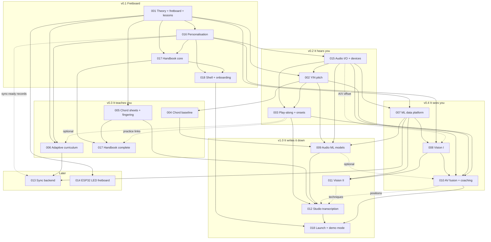

# How FretSense Is Built: Spec-Driven Development With AI Agents

> **For reviewers and recruiters.** FretSense is built with AI agents, but not by "vibe coding".
> Every line of code traces back to an approved requirement. AI subagents act as **reviewers and
> gatekeepers** with narrow permissions, not as free code generators. I hand-write the core
> algorithms (YIN, chromagram, camera homography, Viterbi fingering, knowledge-tracing updates),
> run every ML training experiment, and write every lesson myself. This page explains the
> process, shows the measured results, and keeps an honest log of where the AI got things wrong.
> The skills these features demonstrate are listed in [SKILLS-MATRIX.md](SKILLS-MATRIX.md).

## 1. Principles

These are summarised from [the constitution](../.specify/memory/constitution.md), v2.3.0. The product vision and release plan are in [PRODUCT.md](PRODUCT.md).

- **Specs are the source of truth.** Code that disagrees with the spec is a bug, or a spec change
  that must be approved *first*.
- **Traceability:** `FR-xxx` → task `Txxx` → test or eval → commit `[Txxx][FR-xxx]` → PR.
- **Tests first.** For ML, the dataset card, split, eval harness and baseline come before any model.
- **ML rigor.** Held-out test sets, confusion matrices, per-instrument metrics, model cards, and
  reproducible runs. A model ships only if it beats its baseline.
- **Instrument-agnostic, private, degradable.** Guitar and bass are equal citizens. Camera and mic
  data stay on the device. Everything works audio-only, and the DSP baselines remain available.
- **One task at a time,** each approved by me, with every decision recorded as an [ADR](adr/).

## 2. Subagent gate diagram

```mermaid
flowchart LR
    C[constitution] --> S[specify]
    S --> SR{{spec-reviewer}}
    SR --> LA

    subgraph LA [team loop A: after every specify or spec change]
      direction LR
      PO1{{product-owner<br/>review}} --> UTA{{user-tester<br/>Mode A walkthrough}} --> PO2{{product-owner<br/>triage}} --> ED[apply spec edits]
    end

    LA --> CL[clarify]
    CL --> PO3{{product-owner<br/>proposes answers}} --> OWN[owner answers<br/>NEEDS MAHMOUD]
    OWN --> SR2{{spec-reviewer<br/>no BLOCKERs}}
    SR2 --> PO4{{product-owner<br/>APPROVE}} --> P[plan]
    PO4 -.REVISE/REJECT.-> LA
    P --> AR{{architecture-reviewer}}
    P -.camera/mic/network.-> PA{{privacy-auditor}}
    P -.auth/input/backend.-> SE{{security-reviewer}}
    AR --> CK[checklist] --> T[tasks] --> AN[analyze<br/>no CRITICAL/HIGH]
    AN --> IMPL

    subgraph IMPL [implement: one task at a time]
      direction LR
      TW{{test-writer<br/>red}} --> OK[owner OK] --> I[implement] --> G[green] --> CR{{code-reviewer}}
      CR -.theory/fingering.-> TC{{theory-checker}}
      CR -.DSP/vision/inference.-> PF{{perf-auditor}}
      CR -.models/exports.-> ME{{ml-evaluator}}
      CR -.data/.-> DC{{dataset-curator}}
      CR -.media/network.-> PA2{{privacy-auditor}}
      CR -.auth/deps/CI.-> SE2{{security-reviewer}}
    end

    IMPL -.user-facing task group.-> LB

    subgraph LB [team loop B: after each user-facing task group or release]
      direction LR
      UTB{{user-tester<br/>Mode B hands-on}} --> PO5{{product-owner<br/>fix now / backlog / won't do}} --> CRQ[spec change requests<br/>owner approves before code]
    end

    LB -.approved change.-> S
    IMPL --> CV[converge] --> DK{{docs-keeper}} --> PR[PR + AI involvement]
```

The two team loops add a product view to the technical gates. **product-owner** is a stand-in
for me on *what* to build and *why*: its decisions are proposals, and anything it marks
**NEEDS MAHMOUD** is answered by me, never by an agent. **user-tester** plays five personas
(beginner guitarist, intermediate bassist, self-taught book learner, recruiter with no guitar,
accessibility user) and writes its reports to [`docs/feedback/`](feedback/). Feedback never turns
into code directly: a "fix now" item becomes a spec change request that I approve first.

| Step | Skill | Gated by | What gets checked |
|------|-------|----------|-------------------|
| Principles | `/speckit-constitution` | Owner + ADR | Non-negotiable rules, version bump |
| Requirements | `/speckit-specify`, `/speckit-clarify` | **spec-reviewer**, **product-owner** (APPROVE), **user-tester** (Mode A) + owner | Testable, measurable, per instrument, no conflicts; real user value, scope, personalisation, works gear-free |
| Design | `/speckit-plan` | **architecture-reviewer**, **privacy-auditor**, **security-reviewer**, ADRs | Layering, alternatives, data flows, threat model |
| Requirement quality | `/speckit-checklist` | Owner | Domain checklists (theory, UX/a11y, performance, ML, privacy) |
| Work breakdown | `/speckit-tasks`, `/speckit-analyze` | Owner | Every task → FR, every FR → test or eval, no CRITICAL/HIGH findings |
| Build | `/speckit-implement` | **test-writer** → **code-reviewer** + area gates | Red/green, spec drift, ownership, correctness, regressions |
| Usability | after each user-facing task group or release | **user-tester** (Mode B) → **product-owner** triage → owner | Persona flows, first impression, demo mode, guitar/bass parity, accessibility; "fix now" → spec change request |
| Close-out | `/speckit-converge` | **code-reviewer**, area gates, **docs-keeper** | Nothing unbuilt; docs and skills matrix in sync |

### Subagent roles

| Agent | Permissions | Job |
|-------|-------------|-----|
| [`spec-reviewer`](../.claude/agents/spec-reviewer.md) | Read-only | Finds vague, untestable or missing requirements before planning |
| [`architecture-reviewer`](../.claude/agents/architecture-reviewer.md) | Read-only | Enforces clean-architecture layers and dependency direction |
| [`test-writer`](../.claude/agents/test-writer.md) | Test, fixture, bench and eval-harness files only | Turns FRs into failing tests before implementation |
| [`code-reviewer`](../.claude/agents/code-reviewer.md) | Read-only | Checks diffs against the constitution, spec and tasks, ranked by severity |
| [`theory-checker`](../.claude/agents/theory-checker.md) | Read-only | Spelling, modes, Roman numerals, fretboard math for every instrument, bass patterns |
| [`perf-auditor`](../.claude/agents/perf-auditor.md) | Read-only + runs benchmarks | Per-instrument latency (ADR-0002), fps, inference time |
| [`ml-evaluator`](../.claude/agents/ml-evaluator.md) | Read-only + runs evals | Blocks models without metrics, a confusion matrix, a baseline win or a model card |
| [`dataset-curator`](../.claude/agents/dataset-curator.md) | `data/` and dataset cards only | Label validity, split leakage, card accuracy, consent |
| [`privacy-auditor`](../.claude/agents/privacy-auditor.md) | Read-only | No camera or mic data leaves the device without opt-in |
| [`security-reviewer`](../.claude/agents/security-reviewer.md) | Read-only | Auth, input validation, secrets, supply chain |
| [`docs-keeper`](../.claude/agents/docs-keeper.md) | `README.md` and `docs/` only | Keeps the README, skills matrix, ADR index and diagrams in sync |
| [`product-owner`](../.claude/agents/product-owner.md) | Read-only | My stand-in on WHAT and WHY: reviews specs (APPROVE / REVISE / REJECT), proposes clarify answers, triages feedback; flags NEEDS MAHMOUD; never writes code |
| [`user-tester`](../.claude/agents/user-tester.md) | Read-only + `docs/feedback/` only | Five simulated personas; Mode A spec walkthroughs, Mode B hands-on tests |

## 3. Roadmap: one spec per feature

Specs ship in **product releases** ([PRODUCT.md](PRODUCT.md#release-plan) has each release's goal,
exit criteria and 2-minute demo script). Spec numbers record the order the specs were written.

| # | Feature | Release | Instruments | Status |
|---|---------|---------|-------------|--------|
| 001 | Theory engine, fretboard and lessons; profile-scoped sync-ready data, My Gear instruments, packs format, stage choice | v0.1 | guitar + bass | Clarified; amended for v2.2.0; plan and tasks drafted (finish first) |
| 016 | Personalisation: local profiles, My Gear, onboarding, learning paths, curriculum packs, quality tiers | v0.1 | guitar + bass | Specified; under review |
| 017 | Reference handbook: scales, modes, chords, voicings, arpeggios, intervals, progressions, keys, circle of fifths, glossary; search, favourites, cheat sheets | v0.1 core, v0.3 complete | guitar + bass | Clarified; spec-reviewer PASS WITH NOTES; product-owner APPROVE; owner approval pending |
| 018 | Product shell and launch: landing page, onboarding flow, navigation, design system, states, PWA, deploy, docs; demo mode, opt-in telemetry | v0.1 shell, v1.0 launch | guitar + bass | Clarified; spec-reviewer PASS WITH NOTES; product-owner REVISE on consent scope (owner decision) |
| 015 | Audio I/O and device management | v0.2 | guitar + bass | Clarified; amended for v2.2.0 |
| 002 | DSP pitch detection (YIN) | v0.2 | guitar + bass | Planned |
| 003 | Play-along drills + timing/onset detection | v0.2 | guitar + bass | Planned |
| 006 | Adaptive curriculum: concept DAG, knowledge tracing, spaced repetition, planner (recommends, never locks) | v0.3 | both | Clarified; amended for v2.2.0 |
| 004 | Chord recognition baseline (chromagram templates) | v0.3 | guitar | Planned |
| 005 | Chord sheet analyzer + Viterbi fingering optimizer | v0.3 | guitar + bass | Planned |
| 007 | ML data platform: labelling tool, dataset versioning, training pipeline, tracking, registry | v0.4 | both | Clarified |
| 008 | Vision I: guided camera setup, hand + neck tracking → (string, fret), live highlighting | v0.4 | both | Clarified; amended for v2.2.0 |
| 010 | Audio-visual fusion + camera coaching (009 optional) | v0.4 | both | Specified (draft) |
| 009 | ML audio models: chord CNN + polyphonic transcription (ONNX, int8, browser) | v1.0 | both | Specified (draft) |
| 011 | Vision II: picking hand, posture, technique events | v1.0 | both | Specified (draft) |
| 012 | Studio: transcription to tab and notation (live or recorded; edit, play back, export) | v1.0 | both | Amended and clarified 2026-11-22; spec-reviewer PASS WITH NOTES; product-owner edits applied |
| 013 | Optional sync backend: FastAPI, PostgreSQL, auth | Later | — | Specified (draft) |
| 014 | ESP32 LED fretboard (stretch goal) | Later | guitar | Planned |

Development test tooling (not a feature): an ESP32 LED-flash + piezo-click A/V sync reference (015 FR-027), under `bench/`.

### Dependency graph

Solid arrows are hard dependencies; dotted arrows are optional or "uses when available". Boxes are
grouped by release.

Build order: **v0.1** 001 → 016 → 017 core → 018 shell · **v0.2** 015 → 002 → 003 · **v0.3** 006,
004, 005 → 017 complete · **v0.4** 007 → 008 → 010 · **v1.0** 009 → 011 → 012 → 018 launch ·
**Later** 013, 014.

### Where each employer skill shows up

✔ = a primary demonstration, · = also used. Details and tests are in [SKILLS-MATRIX.md](SKILLS-MATRIX.md).

| Skill | 001 | 016 | 017 | 018 | 015 | 002 | 003 | 006 | 004 | 005 | 007 | 008 | 010 | 009 | 011 | 012 | 013 | 014 |
|-------|-----|-----|-----|-----|-----|-----|-----|-----|-----|-----|-----|-----|-----|-----|-----|-----|-----|-----|
| Data structures & algorithms | ✔ graph | · order keys | ✔ fuzzy search, voicing search | | · ring buffer | · | · ring buf | ✔ DAG, heap | · | ✔ DP/Viterbi, trie | | · | ✔ HMM | | · | ✔ | · | |
| Systems & concurrency |  |  | · audio scheduling | · service worker | ✔ worklet, SAB ring | ✔ Rust/WASM | · |  |  |  | ✔ workers | ✔ WebGPU | · | ✔ | · | · live pipeline |  | ✔ embedded |
| OOP & design patterns | ✔ clean arch, DI | ✔ configurable architecture | · | ✔ component library | ✔ strategy, state machine | ✔ strategy | ✔ event bus | · | ✔ strategy | · | · | ✔ strategy | ✔ observer | ✔ strategy | · | ✔ command (undo/redo) | · | |
| Backend & databases | · IndexedDB | ✔ schema design, sync-ready records | · favourites, sheets | | · IndexedDB prefs | | | · IndexedDB | | | · | | | | | · library | ✔ | |
| Testing | ✔ unit, property, E2E, visual | ✔ property, isolation | ✔ theory fixtures, search fixture | ✔ a11y, visual regression, Lighthouse CI | ✔ mock devices, hot-plug sim, golden audio | ✔ golden audio | ✔ | ✔ | ✔ | ✔ | ✔ | ✔ golden video | ✔ | ✔ ML eval | ✔ | ✔ round-trip, schema | ✔ contract | · |
| DevOps / CI/CD | ✔ CI, preview deploys |  | | ✔ deploy, perf budget gate, releases | · bench CI | · bench CI | | | | | ✔ Docker, ML pipeline | | | ✔ ML eval CI | | | ✔ docker-compose | |
| Performance & observability | · | · tier benchmark | · search/render budgets | ✔ perf budget, opt-in error tracking | ✔ latency bench, overlay | ✔ benchmarks | ✔ | | · | | | ✔ perf overlay | ✔ | ✔ | · | · live latency | · | |
| ML / MLOps |  |  | | · demo through real pipeline | · resampling to model rate |  | · baseline | ✔ KT |  |  | ✔ | ✔ | ✔ | ✔ | ✔ | · |  |  |
| Machine vision |  |  | | | · A/V sync |  |  |  |  |  | · labelling | ✔ | ✔ | | ✔ | · positions |  |  |
| Security & privacy | · CSP, input validation | ✔ import validation | | ✔ opt-in telemetry, scrubbing | ✔ mic indicator, COOP/COEP | | | | | · parser fuzzing | ✔ consent | ✔ on-device | ✔ | | · | · import validation, recording opt-in | ✔ auth, rate limits | |
| Accessibility | ✔ | ✔ keyboard reorder | ✔ text alternatives | ✔ WCAG 2.2 AA, colour-blind tokens | · | | · | · | | · | · | · | · | | | · | | |
| Documentation | ✔ C4, ADRs | · | · | ✔ user guide, FAQ, changelog | · ADR-0005 | · | · | · | · | · | ✔ cards | · | · | ✔ model cards | · | · | ✔ OpenAPI | · |
| Signal processing & hardware |  |  | · synthesis | | ✔ hum, level, clean/effected, resampler | ✔ | ✔ onsets | | ✔ chroma |  |  |  | | ✔ | | · tempo, quantisation |  | ✔ ESP32 |
| Product, UX & release management | · | ✔ onboarding | ✔ interactive reference | ✔ landing, design system, demo mode, releases | · | | | · | | | | · guided setup | | | | ✔ Studio | | |

## 4. Metrics

These come from **measured runs only**, from CI, perf-auditor or ml-evaluator reports linked by
commit, and are reported **per instrument** where it applies. A dash means "not measured yet".
Targets come from the specs and ADR-0002.

| Metric | Instrument | Target | Current | Measured on | Commit / report |
|--------|------------|--------|---------|-------------|-----------------|
| Theory fixtures passing | all | 100% (001 SC-001) | — | — | — |
| Theory engine line / branch coverage | — | ≥ 90% | — | — | — |
| Drill tap → feedback (p95) | — | < 100 ms (001) | — | — | — |
| Onset acknowledgement (p95) | each | ≤ 30 ms (ADR-0002) | — | — | — |
| Pitch-confirmed feedback (p95) | guitar / 4-string bass / 5-string bass | ≤ 50 / 80 / 90 ms (ADR-0002, proposed) | — | — | — |
| Pitch accuracy (± cents, labelled set) | each | spec 002 | — | — | — |
| Chord accuracy: templates vs CNN | each | spec 004 / 009 | — | — | — |
| Fingertip → (string, fret) accuracy | each | spec 008 | — | — | — |
| Vision pipeline fps / latency | each | spec 008 | — | — | — |
| Mastery prediction AUC (KT vs baseline) | — | spec 006 | — | — | — |
| Model size and latency, fp32 vs int8 | — | spec 009 | — | — | — |
| Handbook search: exact top-1 / fuzzy top-3 / per-keystroke p95 | — | 100% / ≥ 95% / ≤ 100 ms (017 SC-002) | — | — | — |
| Lighthouse (Performance, Accessibility, Best Practices, SEO) on named pages | — | ≥ 90 each (018 FR-026) | — | — | — |
| First-time user: landing → first drill answer (median) | — | ≤ 2 min (018 SC-001) | — | — | — |
| Demo mode: Try the demo → transcribed tab | — | ≤ 60 s (018 SC-007) | — | — | — |
| Studio Live: onset → note in tab (p95) | each | ≤ 500 ms (012 FR-011) | — | — | — |
| FRs with ≥1 test or eval | — | 100% | — | — | — |
| Tasks traced to an FR | — | 100% | — | — | — |

## 5. Where the AI got it wrong

This is an honest log of AI output that was rejected, corrected, or caught by a gate. Catching
these mistakes is the point of the process.

| Date | Step / task | Agent | What it produced | What was wrong | How it was caught | What I did |
|------|-------------|-------|------------------|----------------|-------------------|------------|
| 2026-11-21 | 001 specify | AI agent (main session) | First draft of spec 001 | Didn't name a book part (it conflicted with constitution v1). FR-032 said "within 100 ms" on every tap but SC-002 said p95. No octave rule for Cb/B#. No canonical chord-symbol format. Drill questions could be unanswerable. 23 findings in total | **spec-reviewer** returned BLOCK | Findings folded into the amended spec; the book-mapping conflict was resolved in constitution v2.0.0 (ADR-0001) |
| 2026-11-21 | constitution v1 | AI agent (main session) | Wrote "< 30 ms note → screen" as a single budget, from the owner's brief | Never checked it against physics: two periods of a 5-string bass's low B ≈ 69 ms before any processing | Caught while writing the bass amendment | ADR-0002 splits the budget (onset ≤ 30 ms; per-instrument pitch budget); waiting on owner confirmation |
| 2026-11-21 | 006 / 007 / 008 specify | AI agent (main session) | First drafts of the curriculum, data-platform and vision specs | 006: BKT fit could see held-out data, and the split cut sessions in two. 007: no leakage unit for a single performer, owner media could reach CI, the baseline needed the human-owned chromagram. 008: stabilisation alone exceeded the latency budget, v2 was scored against v1's own labels, and press/hover had no ground truth | **spec-reviewer** returned BLOCK on all three (12 blockers) | All findings folded in; the single-performer rule went into constitution v2.1.0 (ADR-0004) |
| 2026-11-21 | repo setup | AI agent (main session) | Made 10 local git commits carrying an AI co-author trailer | The owner commits everything and doesn't want AI credited as a contributor | Owner review | Commits undone with the content kept as uncommitted changes (nothing was pushed); "Git rules" added to CLAUDE.md and the constitution (VII) |
| 2026-11-21 | summary to owner | AI agent (main session) | Reported "9 commits" while listing 10 hashes | Miscounted (two 006 commits) | Owner review | Corrected to 10 |
| 2026-11-21 | all specs | AI agent (main session) | Specs built around the owner's gear and book (Scarlett/Katana defaults, book-part tracks, mastery locks) | Didn't question whether a single-owner design was what the product needed | Owner direction change | Constitution v2.2.0 (ADR-0006), new feature 016, and every spec amended |
| 2026-11-21 | 001 plan | AI agent (main session) | Plan, data model and contracts for 001 | Claimed "the device id is never exported" while every HLC embedded it. Settings were one LWW record although 013 merges per field. Natural-key records (settings, completion) could be duplicated by copy-import or sync. No HLC receive rule. Payload hash and itemKey encodings weren't frozen. "Raw HTML is a build error" had no mechanism. CSP was incomplete, and there was no framing defence | **privacy-auditor**, **architecture-reviewer** and **security-reviewer** all returned CHANGES REQUESTED | All fixed (per-profile writer id, per-field HLC, natural keys, frozen encodings, explicit sanitiser, full CSP, T14–T17); 013 amended to match |
| 2026-11-21 | 001 tasks | AI agent (main session) | tasks.md | A test-writer task edited CI config (outside test-writer scope); several data-model fields lacked explicit citations; FR-043 copy rule contradicted the new natural-key rule | `/speckit-analyze` | Fixed in tasks.md and spec FR-043/FR-066a |
| 2026-11-22 | 017 / 018 / 012 specify | AI agent (main session) | First drafts of the handbook and product-shell specs, and the Studio amendment of 012 | 017: new scales and chords listed by name with no formulas; a wrong edge case (G♯ major does *not* need a triple accidental); "30 keys in the mode it is written for" is self-contradictory; "Practice this" relied on drill sets 001 doesn't have. 018: opt-in telemetry contradicted 001 FR-050 unamended; a "≤ 4 taps" onboarding target that the required steps can't meet; instrument asked twice (016 FR-010 already asks it). 012: the octave convention for notation contradicted itself; "exact" MusicXML round trip included fields MusicXML can't carry | **spec-reviewer** returned BLOCK on all three (9 blockers) | Folded into the specs where the fix is unambiguous; owner decisions batched into the clarify message |
| 2026-11-22 | 017 / 018 clarify | AI agent (main session) | Clarify answers and their fold-in | Left "all 30 keys" in 017 US7's Independent Test after fixing the FRs; the Key row of "Practice this" still had no drill 001 can express; recommended per-device telemetry consent, which sits outside Constitution XIII's "all user data is profile-scoped" | **spec-reviewer** re-review BLOCK (017); **product-owner** flagged the consent scope | 017 fixed; consent scope sent back to the owner |

## 6. AI involvement per PR

Every PR description has an **AI involvement** section listing what the agents generated, what I
changed, what I rejected, and the gate verdicts. The PR history is the full audit trail.
