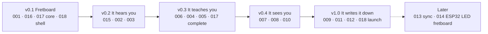

# FretSense: Product

> **The north star.** This page says what FretSense is, who it's for, and the order it ships in.
> Specs say *how much* and *how well*. The [constitution](../.specify/memory/constitution.md) says
> what may never be broken. If this page and the constitution disagree, the constitution wins and
> this page gets fixed. The `product-owner` subagent reads this page before every decision.

## One-line pitch

**FretSense is the guitar and bass teacher, handbook and transcriber in one app. It hears and sees
you play, knows exactly where on the neck you are, and adapts to you.**

## Who it's for

| User | What they have | What they want |
|------|----------------|----------------|
| **Beginner guitar or bass player** | An instrument, a phone or laptop, maybe no interface | To know what to practise, and whether they're doing it right |
| **Intermediate player** | Some theory, maybe an interface or USB amp, any tuning, 4-, 5- or 6+ strings | Fretboard fluency, chord and scale knowledge in every key, honest feedback |
| **Self-taught learner following a book or course** | A theory book or online course, irregular practice | Lessons that follow their book's chapters, freedom to jump around, a reference to check things |
| **Someone evaluating the project** (recruiter, engineer, teacher) | A laptop, no instrument, 60 seconds | To see what it does and how well it's built |

## Problems it solves

1. **Theory books are static.** A book shows one shape, in one key, for standard-tuned 6-string
   guitar. It can't play the sound, follow your tuning, or show the same idea on a 5-string bass.
2. **Practice apps hear pitch, not position.** A tuner-style app knows you played an A. It can't
   tell whether you played it on the right string, so it can't coach position or fingering.
3. **Most apps assume your setup.** They assume guitar, six strings, standard tuning and the app's
   own hardware. They lock lessons behind progress or a paywall, and push one fixed path.
4. **Self-taught players don't know what to practise next**, and forget what they learned last
   month.
5. **Writing down what you played is slow.** Turning a riff or a bass line into tab and notation by
   ear takes longer than playing it.

## Pillars

| Pillar | What the user does | Main specs | First release |
|--------|--------------------|------------|---------------|
| **Learn** | Follows lessons (Read → See → Drill → Play → Camera-coach), on a path built from their goals, in any order | 001, 016, 006 | v0.1 |
| **Look up** | Browses and searches a handbook of scales, chords, voicings, arpeggios, intervals, progressions and keys, all interactive | 017 | v0.1 (core), v0.3 (complete) |
| **Practice** | Runs drills that adapt to weak spots, then play-along drills scored from their real instrument | 001, 003, 006 | v0.1 (tap), v0.2 (play) |
| **Hear and See** | Plugs in any interface (or uses the laptop mic); optionally turns on the camera | 015, 002, 004, 008, 009, 010, 011 | v0.2 (hear), v0.4 (see) |
| **Write** | Records or plays live in the Studio and gets editable tab and notation they can play back and export | 012 | v1.0 |

The **product shell** (018) wraps the pillars: landing page, onboarding, navigation, design
system, accessibility, demo mode and production quality.

## What makes it different

1. **Audio + vision fusion knows exactly where on the neck you're playing.** The same A can be
   played in five places. Audio gives the pitch and the timing, and the camera gives the hand
   position. Fused, they give the string and fret. That makes position coaching possible, and tab
   that's actually right.
2. **Personalised for every user, never locked.** Your instrument, tuning, gear, goals, path,
   lesson stages and curriculum pack. Every lesson and tool is open from day one. The app
   recommends; it never forces.
3. **Any gear, or none.** Any class-compliant interface, USB amp or the built-in mic, on guitar or
   bass, in any tuning. The camera and ML models are optional helpers. Everything works without
   them, and demo mode works with no instrument at all.
4. **Private and offline.** Audio and video are processed on your device and never leave it. No
   account is needed.
5. **Honest engineering.** Every claim is backed by a committed benchmark or evaluation, and every
   model has to beat its DSP baseline before it ships.

## Product principles

1. **Practice first.** If a feature wouldn't help a real practice session, it doesn't ship
   (Constitution VI).
2. **Never locked, always adjustable.** Recommend, don't gate. Every adaptive behaviour has a
   setting (Constitution XIII).
3. **Works with nothing plugged in.** Every screen has a useful gear-free path. Missing gear or
   permissions produce a friendly notice and the next-best option, never a dead end
   (Constitution XI).
4. **Finished means every state.** A screen is done when its loading, empty, error, offline and
   first-run states are designed, not only the happy path.
5. **One design system.** Every screen uses the same tokens and components, in light and dark
   themes, colour-blind safe, keyboard-operable and usable on a phone.
6. **Original content only.** All explanation text is written for FretSense. Nothing is copied from
   books or websites. Curriculum packs may reference a book's chapters, never its text.
7. **Fast and honest.** Pages meet a performance budget. Numbers shown to users or employers come
   from measured runs.
8. **Private by default.** Analytics and error reports are opt-in. Camera and mic are on only while
   a feature needs them, with a visible indicator.

## Non-goals

- **A song library or licensed tab catalogue.** FretSense teaches theory and transcribes *your*
  playing. It doesn't host other people's songs.
- **Copying books or courses.** Packs map lessons to chapters; they never contain book text.
- **A DAW, amp simulator or effects suite.** Backing loops and playback exist to support practice,
  not production.
- **Social features**: feeds, leaderboards, sharing networks.
- **Accounts, ads or selling data.** Optional sync (013) is opt-in and later.
- **Cloud inference.** Models run on the device.
- **Native app-store apps.** It's an installable PWA. A native desktop audio backend is a stretch
  goal (ADR-0005).
- **Instruments outside the guitar and bass families** (ukulele, banjo and so on) are not tested or
  promised, even though instrument profiles are generic.
- **Live human teaching** or a tutor marketplace.

## Release plan

Each release is usable on its own, deployed, and has a demo script that fits in **2 minutes**.
Specs are numbered by when they were written, not by when they ship.

### Exit criteria for every release

These apply to every release, on top of the release's own criteria:

- Every included spec has passed `/speckit-converge`. Every FR has a passing test or evaluation,
  and every success criterion is met on a **measured** run, recorded in `docs/AI-WORKFLOW.md` §4.
- **user-tester** Mode B on the release scores ≥ 4 stars, with no open BLOCKER or MAJOR finding.
- Deployed to the production URL. Lighthouse ≥ 90 in Performance, Accessibility, Best Practices
  and SEO on the pages named in 018. A changelog entry and release notes are published.
- The demo script below runs in ≤ 2 minutes on the production URL, rehearsed by the owner.

### v0.1 "Fretboard": usable with no gear

- **Goal:** a complete, polished theory product that needs nothing but a browser. A learner gets
  a personal path, interactive lessons, tap drills and a searchable handbook, on their own
  instrument and tuning, offline.
- **Specs:** 001 (theory engine, fretboard, lessons, tap drills); 016 (profiles, My Gear,
  onboarding, paths, packs); 017 core (handbook entries, search, favourites, links to lessons and
  drills); 018 shell and onboarding (landing page, navigation, design system, states, PWA,
  deploy, user docs).
- **Exit criteria:** a new user goes from the landing page to their first drill answer in ≤ 2
  minutes with no gear (018). The 001 theory fixtures pass 100%. Handbook search meets 017
  SC-002. The app works offline after the first load.
- **Demo script (2 min):**
  1. Open the URL on a phone. The landing page explains the product in one screen. Tap **Try it
     now**.
  2. Onboarding: pick a 5-string bass and the goal "solo over blues". A suggested path appears.
  3. Handbook: search "dorian", see it on the 5-string neck, switch the labels to degrees,
     transpose to A, and press play.
  4. Tap **Practice this** and answer three note-finding questions. Open **Progress**.
  5. Switch to airplane mode and show it still works. Close with the repo: spec → task → test →
     commit traceability.

### v0.2 "It hears you"

- **Goal:** the app listens to the user's real instrument, through any interface, USB amp or the
  laptop mic, and scores play-along drills on pitch and timing within the latency budgets.
- **Specs:** 015 (audio I/O and devices), 002 (YIN pitch detection), 003 (play-along drills and
  onsets).
- **Exit criteria:** onset acknowledgement ≤ 30 ms p95 and pitch-confirmed feedback within the
  ADR-0002 budget, per instrument, on the reference setup. Hot-plug simulation passes. The app
  still works fully with no device connected.
- **Demo script (2 min):**
  1. Plug a guitar into any interface. The device is detected and the input level shows.
  2. Unplug it mid-session: a friendly notice, no crash. Plug it back in.
  3. Run a play-along drill on a scale at 90 BPM, and show per-note pitch and timing feedback.
  4. Turn on the latency overlay and show the measured numbers against the budget.
  5. Repeat one drill on bass to show both instruments are first-class.

### v0.3 "It teaches you"

- **Goal:** the app plans practice. It tracks what the user knows, schedules review, recognises
  chords, finds playable fingerings, and the handbook is complete.
- **Specs:** 006 (adaptive curriculum), 004 (chord recognition baseline), 005 (chord sheet analyzer
  and fingering optimizer), 017 complete (voicing finder, progression explorer, cheat sheets).
- **Exit criteria:** 006's knowledge-tracing gate beats its baseline on the held-out set. Chord
  recognition meets 004's accuracy targets per instrument. 005's fingerings match the golden set.
  Every 017 entry type is live.
- **Demo script (2 min):**
  1. Open **Home**: today's practice, planned from the learner model, with a reason for each item.
  2. Strum a chord: it's recognised and named.
  3. Paste a chord sheet: keys, Roman numerals and a playable fingering appear.
  4. Handbook: open the voicing finder for Cmaj7, ranked by playability. Then pick ii–V–I in B♭,
     play the backing loop, and see the scales to solo over.
  5. Add both to a cheat sheet and export it as a PDF.

### v0.4 "It sees you"

- **Goal:** with the camera on, the app knows which string and fret each fingertip is on, and
  fuses that with audio to coach positions.
- **Specs:** 007 (ML data platform), 008 (hand and neck tracking), 010 (audio-visual fusion and
  coaching; uses 009 when it ships, optional until then).
- **Exit criteria:** 008's fingertip → (string, fret) accuracy and fps targets are met per
  instrument. Fusion beats both single-modality baselines (010). Dataset cards and evaluation
  reports are committed. Everything still works with the camera off.
- **Demo script (2 min):**
  1. Guided camera setup in under a minute.
  2. Live highlighting: the fretboard on screen lights up where the fingers are.
  3. Play the same pitch in two positions. Audio alone can't tell them apart; fusion can.
  4. A drill flags "right note, wrong position".
  5. Show the dataset card and the evaluation report with the baseline comparison.

### v1.0 "It writes it down"

- **Goal:** the full product. The Studio turns playing into editable, playable, exportable tab and
  notation. ML models beat their DSP baselines. Technique coaching is on. Demo mode lets anyone see
  everything in 60 seconds with no gear.
- **Specs:** 009 (ML audio models), 011 (picking hand, posture and technique), 012 (Studio:
  transcription to tab and notation), 018 launch polish (demo mode, analytics and error tracking,
  full docs).
- **Exit criteria:** 009 models beat their baselines by the spec's margins, per instrument. 012's
  note and position accuracy targets are met. Demo mode reaches a transcribed tab within 60 s of
  pressing **Try the demo** on the reference laptop. Exports open in at least one independent
  application.
- **Demo script (2 min):**
  1. On the landing page, press **Try the demo**. No guitar, no permissions asked.
  2. A bundled clip plays through the real pipeline: the pitch trace, the hand overlay, then tab
     and notation appear in the Studio.
  3. Fix one note in the editor, play it back, and export MusicXML and PDF.
  4. Switch to a live guitar and play a riff: tab appears as it's played.
  5. Show a model card: CNN vs DSP baseline, per instrument, fp32 vs int8.

### Later

- **013 Optional sync backend**: multi-device sync, opt-in only.
- **014 ESP32 LED fretboard**: a hardware fretboard that lights up the positions the app shows.

## Where this is tracked

- Roadmap table and dependency graph: [AI-WORKFLOW.md §3](AI-WORKFLOW.md#3-roadmap-one-spec-per-feature)
- Skills each feature demonstrates: [SKILLS-MATRIX.md](SKILLS-MATRIX.md)
- Specs: [`specs/`](../specs/)
